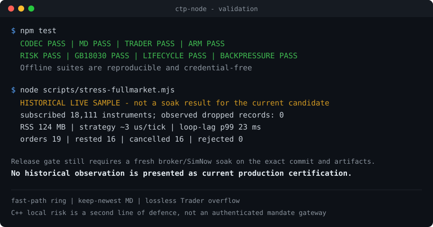

<!-- LANG-SWITCH -->
<p align="right"><b>English</b> · <a href="README.zh-CN.md">简体中文</a></p>

<h1 align="center">ctp-node</h1>

<p align="center">
  <b>High-performance, type-safe <a href="http://www.sfit.com.cn/">CTP</a> (上期技术) binding for Node.js</b><br/>
  for programmatic / quantitative Chinese-futures trading.
</p>

<p align="center">
  <a href="https://github.com/hitrading/ctp-node/actions/workflows/build.yml"></a>
  <a href="LICENSE"></a>
  
  
  
  
</p>

<p align="center">
  
</p>

- **Plain objects, idiomatic TypeScript.** Every CTP struct is a generated `interface` with camelCase fields (`tick.lastPrice`, `tick.instrumentId`); every CTP enum is a real TS `enum`. No hand-written marshalling.
- **Fast.** The isolated generated 46-field decoder runs at about **8M ticks/sec**. More importantly, the reproducible native-SPI-to-JS full-path probe sustained 500k ticks/sec across 18,111 real cache keys with zero drops and delivered an 18,111-tick all-contract callback storm intact on the measured host; see [Performance & memory](docs/troubleshooting.md#performance--memory) for hardware, CPU/RSS and limits.
- **Hybrid API.** `EventEmitter` for streaming pushes (`rtn-depth-market-data`, `rtn-order`…) + `Promise` for request/response (login, queries, orders), correlated by request id with multi-row accumulation.
- **Pre-trade risk in C++.** Kill-switch, max order volume, max notional, price-deviation (fat-finger) guard, account-wide and per-instrument open-position margin caps, per-instrument max position (lots, per side), and a token-bucket rate limiter are enforced on the order path in native code — a JS GC pause can't defeat them.
- **Stable by construction.** No hand-marshalling, threadsafe-functions released properly, `Init()` deferred so `front-connected` is never missed, compiler-truth (`offsetof`) binary layout, gb18030 decoded in JS (no Windows code-page bug).

> Targets the regime CTP actually supports (snapshot-driven, ms-tolerant strategies: CTA, arbitrage, market making). True microsecond HFT is not achievable through CTP in any language.

> **Boundary:** this package is an in-process protocol binding and local second
> line of risk. It does not authenticate callers, verify signed mandates, or own
> an external heartbeat watchdog. Production use still requires an authenticated
> gateway/supervisor and a fresh soak of the exact commit and packaged binaries.
> The protocol surface is broader than the local ledger: quantitative admission
> is complete only for ordinary single-leg orders; quote/exec/comb/parked and
> similar advanced mutations are binding-only and rejected whenever local risk
> is enabled. Until the exact `3.0.0-rc` artifact passes that soak and the external
> mandate/watchdog controls exist, the production-live decision remains **No-Go**.

## Requirements

Node 22.22.2+ on supported even-numbered release lines (`^22.22.2 || ^24.15.0 || >=26.0.0`). This mirrors the Node.js range required by the bundled `node-gyp`; odd-numbered/EOL releases and Node 24.0–24.14 are not supported. Prebuilt binaries are shipped for **Windows and Linux (x64)** — most users need no compiler there. **macOS (and any other platform) builds from source on install**, which needs a C++ toolchain (macOS: Xcode Command Line Tools; Windows: VS Build Tools; Linux: clang/gcc). The CTP shared libraries are bundled next to the loaded addon and resolved automatically.

## Install

```sh
npm install @hitrading/ctp-node
```

Works in **TypeScript or JavaScript**, as **ESM (`import`) or CommonJS (`require`)** — the package ships both builds plus `.d.ts` type declarations, so it loads whatever your project's module setting emits:

```ts
import { Trader, MarketData } from "@hitrading/ctp-node";       // ESM / TypeScript
```
```js
const { Trader, MarketData } = require("@hitrading/ctp-node");  // CommonJS
```

## Documentation

- **Full API reference** — every TypeScript/JavaScript interface and method, with each parameter's type and meaning, plus usage examples: [English](docs/API.md) · [简体中文](docs/API.zh-CN.md)
- Architecture & native internals — the lock-free data plane, the C++ risk engine, backpressure, and the create-once process-lifecycle notes: [English](docs/native-hooks.md) · [简体中文](docs/native-hooks.zh-CN.md)
- **Troubleshooting & FAQ** — connection/front rotation, login & authentication, query rate limits, order rejections, limit-down, lifecycle, build issues, CTP error codes: [English](docs/troubleshooting.md) · [简体中文](docs/troubleshooting.zh-CN.md)
- **Testing & coverage** — full offline regression plus a credential-gated SimNow suite that must be run separately; historical samples are not a soak result for the current candidate: [integration & testing](docs/integration.md)
- **Releasing** — fully automatic `semantic-release` (Conventional Commits → version + CHANGELOG + GitHub Release + npm publish): [RELEASING.md](RELEASING.md) · [CHANGELOG.md](CHANGELOG.md)

## Quick start — market data

```ts
import { MarketData } from "@hitrading/ctp-node";

const md = new MarketData("./flow/md/", "tcp://182.254.243.31:30012");

md.on("front-connected", async () => {
  await md.login({ brokerId: "9999", userId: "xxxx", password: "xxxx" });
  md.subscribe(["rb2510", "ag2512"]);
});

md.on("rtn-depth-market-data", (tick) => {
  // tick is a plain object with camelCase fields
  console.log(tick.instrumentId, tick.lastPrice, tick.bidPrice1, tick.askPrice1);
});

// After a successful MD login, market data is cached in C++ (a last-value cache,
// updated before each authenticated-session tick reaches JS), so you get a
// synchronous snapshot with no bookkeeping in JS:
//   md.snapshot("rb2510");  // latest full depth tick (DepthMarketData) or null
//   md.last("rb2510");      // latest price, 0 if none seen yet
```

## Quick start — trading

```ts
import { Trader } from "@hitrading/ctp-node";

const td = new Trader("./flow/td/", "tcp://182.254.243.31:30002");

// Pre-trade risk, enforced in C++ on every order:
td.setRiskLimits({ maxOrderVolume: 10, maxOrdersPerSec: 20, maxPriceDeviation: 0.02, maxAccountMargin: 2_000_000 });
td.trackMarketData(md); // fresh C++ reference for deviation, notional and margin gates
td.setInstrumentPositionLimits({ rb2610: 100, au2610: 10, ru2610: { long: 100, short: 20 } });
td.setInstrumentMarginLimits({ ag2608: 2_000_000, au2608: 5_000_000 });              // per-instrument scheduled-margin caps

td.on("front-connected", async () => {
  // One-call handshake (call again after a reconnect). Margin-rate queries need
  // an explicit bounded trading universe (one CTP query per contract).
  await td.session({ brokerId, userId, password, appId, authCode,
    sync: { marginRates: ["rb2510", "ag2608", "au2608"] } });

  // ...or hand-roll it if you need finer control:
  //   await td.reqAuthenticate({ brokerId, userId, appId, authCode });
  //   await td.reqUserLogin({ brokerId, userId, password });
  //   await td.reqSettlementInfoConfirm({ brokerId, investorId }); // real accounts
  //   await td.syncMultipliers(); await td.syncMarginRates(["rb2510"]);
  //   await td.syncOrders(); await td.syncPositions(); // held snapshot must be last

  // Promise-based queries return all rows:
  const positions = await td.reqQryInvestorPosition({ brokerId, investorId });

  // Orders go through the C++ risk gate. reqOrderInsert resolves on submission
  // (CTP sends no ack for an accepted order); track the outcome via rtn-order /
  // rtn-trade. orderRef is auto-assigned a unique value if you leave it blank.
  await td.reqOrderInsert({
    brokerId, investorId, instrumentId: "rb2510",
    direction: "0", combOffsetFlag: "0", // buy-open; see enums
    limitPrice: 3500, volumeTotalOriginal: 1,
  });
});

td.on("rtn-order", (order) => console.log("order update", order.orderStatus));
td.on("rtn-trade", (trade) => console.log("filled", trade.price, trade.volume));

// Atomic modes: reduceOnly() keeps closes+cancels; haltAll() blocks closes too.
// Multi-leg combOffsetFlag values are rejected until a per-leg ledger exists.
// td.reduceOnly();  /  td.haltAll();  /  td.resume();
```

### Armed orders (latency-critical)

Fire an order from C++ the instant the market hits your trigger — evaluated on
the market-data callback thread, through the risk gate, with **no JS in the
loop** (no event-loop hop, no GC exposure):

```ts
const armed = trader.arm(md, {
  instrumentId: "rb2510",
  side: "buy",            // buy fires when ask ≤ trigger; sell when bid ≥ trigger
  triggerPrice: 3500,
  order: {
    brokerId, investorId, instrumentId: "rb2510", direction: "0", combOffsetFlag: "0",
    limitPrice: 3500, volumeTotalOriginal: 1, orderRef: "900001",
  },
});
// Removed after a successful send; refusal stays armed with bounded exponential backoff.
// armed.disarm();
```

Enums are exported and typed:

```ts
import { Direction, OffsetFlag } from "@hitrading/ctp-node";
Direction.Buy;   // "0"
Direction.Sell;  // "1"
```

## API shape

- `new MarketData(flowPath, fronts)` / `new Trader(flowPath, fronts)` — `fronts` is a `tcp://` address or an array.
- Requests are camelCase methods taking a `Partial<...>` of the CTP field object and returning a `Promise`. Request objects are strict plain objects: unknown/inherited/removed fields and `null` field values are rejected instead of ignored. Input arrays must be dense and use explicit own entries; sparse/prototype-provided values are rejected. `reqQry*` resolve with an array of rows; most requests resolve with the single response row.
- All `reqQry*` / `reqQuery*` calls on one client are snapshotted, serialized and paced internally (one in flight, at least 1100 ms between attempted sends), so callers must not add `setTimeout(1000)`. The bounded queue is per client; raw queries are paced but only `sync*` helpers retry transient flow control.
- Exchange-bound inserts/actions (`reqOrderInsert`, `reqOrderAction`, …) resolve on **submission** — CTP returns no success response for an accepted order, only `rtn-order` / `rtn-trade` (correlate by `orderRef`). They reject only if the send is refused (risk gate, rate limit, or a CTP API error code).
- Streaming events use kebab-case names (`rtn-depth-market-data`, `rtn-order`, …); handlers get `(data, options)` where `options` carries `{ requestId?, isLast?, rspInfo? }`.
- The latest tick per instrument is kept in a C++ last-value cache. It is invalid before a successful MD login; login opens a new empty epoch, and connect/disconnect, a new login/logout attempt, successful logout, and close invalidate and clear it. Only later ticks in the authenticated epoch update the cache or drive armed orders. `md.snapshot(instrumentId)` returns the latest full `DepthMarketData` (or `null`) and `md.last(instrumentId)` the latest price (0 if none) synchronously. The same epoch-bound cache backs the price-deviation guard.
- `client.droppedRecords` reports records dropped under backpressure. Market
  data uses bounded keep-newest staging and retains the freshest quote;
  the trader uses a lossless ordered overflow queue, so order/trade/query returns
  are not deliberately discarded when its 4096-slot ring fills. Sustained Trader
  overload can therefore consume memory: keep handlers bounded and monitor lag.
- `client.close()` releases the underlying CTP API. Call it **once**, at shutdown — a CTP client is create-once / reuse; reconnecting by recreating it deadlocks in the vendor DLL (see [Lifecycle](#lifecycle-create-once-reuse)).

## Lifecycle: create once, reuse

Create a `MarketData` / `Trader` **once** and keep it for the life of the
process. CTP reconnects on its own; handle a dropped link **in place** by
re-running your handshake when `front-connected` fires again (it fires on the
first connect *and* on every auto-reconnect) — never by destroying and
recreating the client.

```ts
const md = new MarketData("./flow/md/", front);
md.on("front-connected", async () => {     // first connect AND every reconnect
  await md.login({ brokerId, userId, password });
  md.subscribe(["rb2510"]);
});
// Trader: re-run the one-call handshake the same way
td.on("front-connected", () => td.session({ brokerId, userId, password, appId, authCode }));
```

> **Why.** `close()` calls the vendor `CThostFtdc*Api::Release()`. Repeated
> `Init()`/`Release()` cycles have been observed to deadlock inside the Windows
> vendor DLL; the binding cannot safely recover a process from that state. A
> "reconnect by recreate" loop will hang the whole process (and on Windows the
> wedged process ignores `SIGTERM`, so it must be force-killed with `taskkill /F`
> — until then it locks `build\Release\ctp.node` and breaks the next native
> build). Construct each client once and call `close()` only at shutdown. A
> one-time `console.warn` fires if an unusual number of clients are
> created/closed in a process (tune/disable with `CTP_RECREATE_WARN`). Details:
> [docs/native-hooks.md](docs/native-hooks.md#process-lifecycle-create-once-reuse).

## Architecture

```
CTP callback thread (C++)                 Node event loop (JS)
  OnRtn.../OnRsp... → memcpy bytes  ──►   coalesced doorbell → drain whole batch
  into lock-free SPSC ring,                → decode each record from the ring
  bump atomic index, ring doorbell           (monomorphic generated decoder)
  (on overflow: MD stages/evicts oldest,      → plain object → emit / resolve
   trader spills losslessly in order)
```

Everything below the public API is generated from the CTP headers
(`ctpsdk/ThostFtdc*.h`) by `scripts/codegen/` — 519 struct interfaces, 326
enums, field layout tables (via `offsetof`), and the full trader SPI + request
dispatch. Run `npm run gen` after updating the headers.

## Build from source

```sh
npm run gen      # regenerate from CTP headers
npm run build    # gen + native (node-gyp) + tsc
npm test         # codec round-trip + md + trader (no network needed)
npm run bench    # decode throughput
```

## License

Apache-2.0
